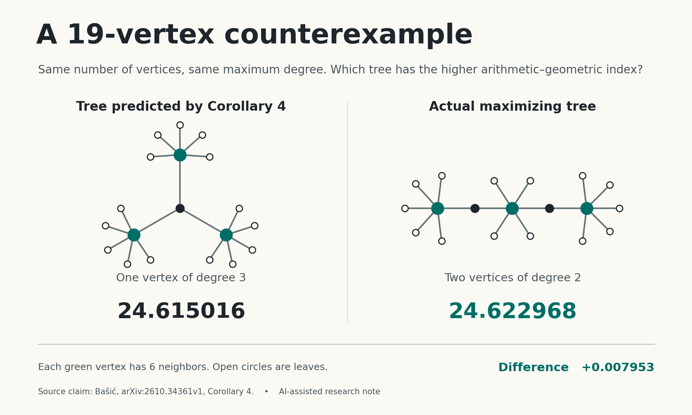

# Counterexamples in graph theory

**AI-assisted research notes · 26 November 2026**

## A predicted maximum beaten on 19 vertices

Corollary 4 of Milan Bašić’s October 25 preprint specifies which trees maximize the arithmetic–geometric index when the maximum degree lies between three and eight. At 19 vertices and maximum degree six, its predicted tree places **second** among all 44,195 eligible tree shapes. The unique winner has two intermediate vertices of degree two. The predicted tree has one of degree three. [Original preprint, Corollary 4](https://arxiv.org/html/2610.34361v1#S2.SS2)

| Read | Result |
|---|---|
| [Two-tree counterexample](geometric-index/README.md) | Exact positive score difference. The same gap persists at every order $19+5t$ for integers $t\ge0$. |
| [Corrected maximizer classification](classification/proof.md) | A characterization of every maximizer for maximum degrees 3 through 8 in an explicit size range for each remainder. Includes a proof of uniqueness at 19 vertices. |
| [Exhaustive census](audits/order19.json) | An independent calculation compared all 317,955 unlabeled trees of order 19, including 44,195 of maximum degree six. It certified the winner and runner-up with rigorous integer bounds. |

Each edge contributes a score determined by its endpoint degrees. Moving from the predicted tree to the winner removes one leaf edge between degrees one and six, removes three edges between degrees three and six, and adds four edges between degrees two and six. The score increases by $(16\sqrt2-9\sqrt3-7)/(2\sqrt6)$. The diagnosis in the proof is that the positive cost of an intermediate vertex depends on its degree. Using fewer incidences can incur a higher total cost.

## Reproduce the results

Run these commands from the repository root with Python 3.10 or later and assertions enabled. The first two checks use the standard library. The census uses NetworkX 3.4.2 and writes the expected JSON to a path supplied by the caller.

~~~sh
python geometric-index/verify.py
python classification/check.py
python -m pip install networkx==3.4.2
python audits/enumerate_order19.py order19-replay.json
~~~

## Other checks

- [A sigma-index tie at ten vertices](sigma-index/note.md) concerns Corollary 6 of Bašić’s earlier October 14 preprint. Maximizers for this degree range were studied before that preprint.
- [Two candidate graph inequalities with unbounded counterexamples](autographforge/note.md) concerns computational conjectures released with Pastorek’s AutoGraphForge study. Each has a short mathematical proof and an [exact checker](autographforge/check.py).

OpenAI Codex assisted with literature searches, constructions, proofs, code, verification and writing. The direct comparison, general argument and census were produced in the same AI-assisted investigation. Independent human review and priority remain outstanding. The search identified earlier work on maximum degree at most four and found no earlier report of the degree-six pair in the sources consulted. [Literature and scope](geometric-index/README.md#prior-work-and-reproducibility)
